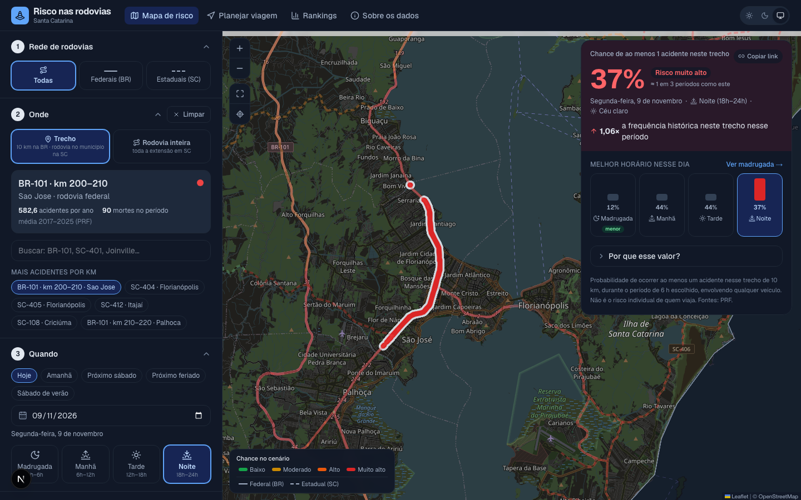
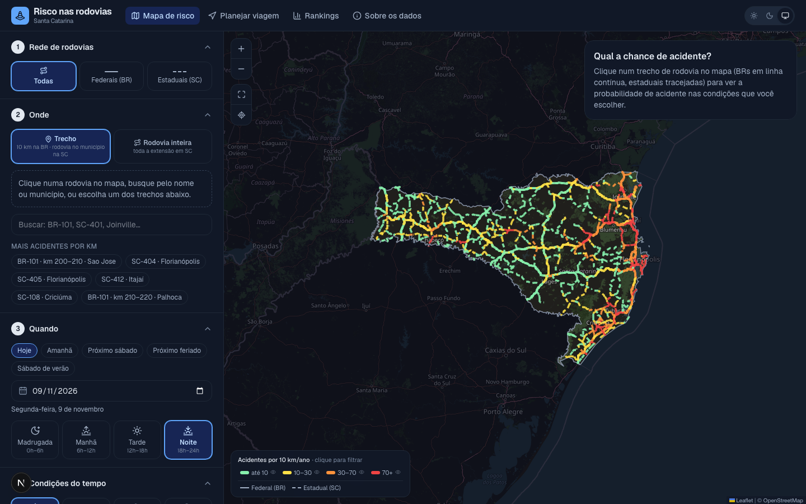
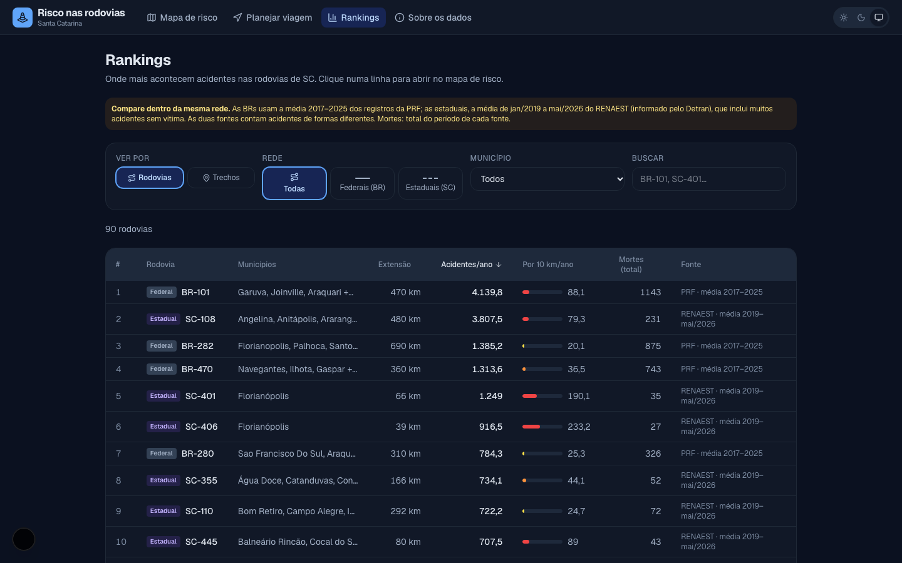

# Risco de acidentes nas rodovias de Santa Catarina

**Projeto final de Aprendizagem de Máquina** · Gustavo Ross · Kevin C. El Azar · Guilherme Assis

Dois modelos de classificação estimam a **chance de acontecer ao menos um acidente** num trecho de rodovia de SC,
num dia e num período do dia (madrugada, manhã, tarde, noite), a partir de dados abertos de acidentes, clima,
tráfego e geometria das vias. O resultado pode ser consultado numa interface web com mapa, num script de linha de
comando ou no notebook final.



## Objetivo e público-alvo

**Problema:** acidentes se concentram em poucos trechos e variam com o dia, o horário e o clima, mas essa
informação está espalhada em bases públicas difíceis de cruzar. O projeto transforma essas bases numa pergunta
simples: *qual a chance de acidente neste trecho, neste dia e neste período?*

| Quem usaria | Para quê |
|---|---|
| Motoristas e transportadoras | escolher horário e rota de viagem; ver quais trechos do caminho pedem mais atenção |
| PRF e DER/SC | decidir **onde e quando** concentrar fiscalização, sinalização e atendimento |
| Defesa Civil, municípios, imprensa | priorizar trechos críticos e comunicar risco em feriados e na temporada de verão |

Há um modelo para cada rede de rodovias, porque as fontes são diferentes:

- **BRs (federais):** acidentes da PRF de 2017–2025, em trechos de 10 km;
- **SC-xxx (estaduais):** acidentes do RENAEST de jan/2019 a mai/2026, com a rodovia dentro de cada município como
  trecho.

## Estrutura do repositório

```
projeto_final.ipynb       notebook final: problema → dados → tratamentos → modelo → avaliação → erros → demonstração
notebooks/estudos/        estudos intermediários (primeiro modelo; exploração, correlação e PCA com a PRF 2025)
backend/                  Python: preparação dos dados, treino, API (FastAPI) e script de demonstração
frontend/                 Next.js + Leaflet/OpenStreetMap: interface web
docs/                     capturas de tela e roteiro da apresentação
dados_externos/           bases baixadas pelos scripts (fora do git)
```

## Dados

| Fonte | O que traz | Uso |
|---|---|---|
| [PRF – Dados Abertos](https://www.gov.br/prf/pt-br/acesso-a-informacao/dados-abertos/dados-abertos-da-prf) | Acidentes nas BRs, 2017–2025 ("Agrupados por pessoa – Todas as causas e tipos"): data, hora, BR, km, coordenadas, vítimas | Alvo e histórico da rede **br** |
| [RENAEST/Senatran](https://dados.transportes.gov.br/dataset/renaest) | Acidentes de todas as vias informados pelos Detrans (~530 MB) | Alvo e histórico da rede **sc** |
| [OpenStreetMap / Overpass](https://overpass-api.de/) | Geometria das BRs e rodovias estaduais; nomes de todas as vias | Trechos, casamento de endereços, mapa |
| [IBGE – API de malhas](https://servicodados.ibge.gov.br/api/docs/malhas) | Limites dos municípios | Trecho estadual = rodovia × município |
| [Open-Meteo](https://open-meteo.com/) | Clima histórico (reanálise ERA5) e previsão de até 16 dias | Chuva, nebulosidade, temperatura |
| [DNIT – Fatores VMD e UPE](https://www.gov.br/dnit/pt-br/rodovias/operacoes-rodoviarias/faixa-de-dominio) | Volume médio diário de veículos por segmento das BRs (PDF) | Variável de tráfego (BRs) |
| [OSRM](https://project-osrm.org/) e [Nominatim](https://nominatim.org/) | Rotas e busca de endereços | Interface e script de demonstração |

Todas as bases são baixadas pelos scripts. A PRF fica no Google Drive do órgão e é baixada com `gdown`; se o
Drive bloquear, o erro explica como baixar o ZIP do ano à mão para `dados_externos/prf/`. Os dados do
OpenStreetMap são © colaboradores do OpenStreetMap (ODbL); os do Open-Meteo, CC BY 4.0.

## Como rodar

Pré-requisitos: Python **3.12+**, e Node 20+ com pnpm para a interface.

### Rápido: com os modelos já treinados (recomendado para avaliar)

```bash
cd backend
python3.12 -m venv .venv
.venv/bin/pip install -r requirements-notebook.txt   # inclui requirements.txt + Jupyter/matplotlib
.venv/bin/python -m scripts.baixar_artefatos         # ~26 MB da Release do GitHub → backend/artifacts/

# demonstração pela linha de comando
.venv/bin/python -m scripts.prever --rodovia BR-101 --km 205 --data 2026-12-24 --periodo noite --clima chuva_forte
.venv/bin/python -m scripts.prever --rodovia SC-401 --municipio Florianópolis --periodo tarde
.venv/bin/python -m scripts.prever --endereco "Ponte Hercílio Luz, Florianópolis" --periodo manha

# interface web (a partir da raiz do repositório)
cd .. && (cd frontend && pnpm install) && bash rodar.sh   # API :8000 + interface http://localhost:3000
```

O notebook final (`projeto_final.ipynb`) roda a partir da raiz do repositório com o kernel do `.venv`, em menos de
um minuto, sem baixar nada.

### Completo: reproduzir do zero

Baixa ~700 MB de bases públicas e leva bastante tempo, principalmente pelo clima (o script respeita o limite do
Open-Meteo gratuito, espera e continua; se parar, rode de novo, porque os lotes ficam em cache).

```bash
cd backend
.venv/bin/python -m scripts.preparar_dados         # BRs: PRF 2017–2025 + geometria OSM + VMD DNIT + clima
.venv/bin/python -m scripts.treinar                # treina, avalia e salva em artifacts/
.venv/bin/python -m scripts.preparar_estaduais     # estaduais: RENAEST + IBGE + OSM, casa endereços, clima
.venv/bin/python -m scripts.treinar --rede sc      # salva em artifacts/estaduais/
.venv/bin/python -m scripts.relatorio_dados --comparar   # qualidade dos dados e evolução das métricas
.venv/bin/python -m pytest -m "not externo"        # testes (sem chamar serviços externos)
```

`python -m scripts.empacotar_artefatos` gera o `dist/artefatos.zip` publicado na Release.

## Metodologia

**Unidade de previsão:** trecho × dia × período de 6 h. Alvo = 1 se houve ao menos um acidente (2–3% dos casos).

| Etapa | Onde | O que faz e por quê |
|---|---|---|
| Dados PRF | `backend/app/dados.py` | Filtra SC e passa de uma linha por pessoa para uma por acidente; valida datas e coordenadas; define o trecho (BR + faixa de 10 km) |
| Dados RENAEST | `backend/app/renaest.py`, `vias.py` | O RENAEST de SC não tem coordenadas nem km, só o endereço digitado. O endereço é limpo e casado com uma via do OSM no mesmo município (~90% casam). Uma rua só herda o código da rodovia se a maioria dos seus segmentos é rodovia, para uma rua inteira não virar SC-xxx por causa de um segmento |
| Trechos | `backend/app/osm.py` | Construídos pela geometria do OSM, não só onde houve acidente: evita o viés de só olhar trechos perigosos (26 trechos estaduais entram com zero acidentes) |
| Tráfego | `backend/app/trafego.py` | VMD do DNIT por trecho de 10 km, ponderado pela extensão |
| Clima | `backend/app/clima.py` | Clima **de todos os dias** (o campo de clima da PRF só existe quando houve acidente e vazaria o alvo). Falhas são preenchidas pela climatologia, não por 0 |
| Features | `backend/app/features.py` | Histórico do trecho só até o dia anterior (sem vazamento), calendário (feriado, véspera, verão, pandemia), período, localização, clima, VMD e nível de notificação do RENAEST. **Mesmo código no treino e na API** |
| Modelo | `backend/scripts/treinar.py` | `HistGradientBoostingClassifier`, um por rede: capta interações, aceita ausentes e categorias, com restrição monotônica no histórico. Regressão logística e PCA foram testados nos estudos e ficaram abaixo |
| Avaliação | `backend/scripts/treinar.py` | **Divisão temporal**: treina no passado e testa no último ano. ROC-AUC, PR-AUC, Brier, calibração, captura top-k, clima por subconjunto, importância por permutação e análise de erros por trecho, período e mês |

Detalhes, gráficos e justificativas de cada tratamento estão no [`projeto_final.ipynb`](projeto_final.ipynb).

## Resultados

**BRs** (249 trechos; treina em jul/2017–dez/2024, testa em 2025):

| Modelo | ROC-AUC | PR-AUC | Top 10% captura |
|---|---|---|---|
| HistGradientBoosting com clima (em uso) | 0,825 | 0,145 | 51% |
| HistGradientBoosting sem clima | 0,825 | 0,144 | — |
| Só o histórico do trecho no período | 0,818 | 0,135 | 50% |
| Chute aleatório | 0,5 | 0,021 | 10% |

**Rodovias estaduais** (443 trechos; treina em jul/2019–mai/2025, testa em jun/2025–mai/2026):

| Modelo | ROC-AUC | PR-AUC | Top 10% captura |
|---|---|---|---|
| HistGradientBoosting com clima (em uso) | 0,896 | 0,328 | 66% |
| HistGradientBoosting sem clima | 0,895 | 0,328 | — |
| Só o histórico do trecho no período | 0,894 | 0,315 | 65% |
| Chute aleatório | 0,5 | 0,029 | 10% |

"Top 10% captura": parcela dos trecho-períodos com acidente no ano de teste que caem nos 10% apontados como mais
arriscados. Acurácia não é usada: prever sempre "sem acidente" acertaria ~98%.

**Conclusões:**

1. **O risco é sobretudo uma questão de *onde*.** O modelo supera todas as linhas de base, mas por pouco o
   histórico do trecho: a maior parte do sinal está nele. Para decidir onde fiscalizar, o histórico já diz muito;
   o modelo acrescenta o *quando* (período, dia, feriado) de forma consistente.
2. **As probabilidades são calibradas:** na média, o previsto ficou em 96% (BRs) e 99% (estaduais) do observado,
   e a curva de calibração segue a diagonal. Por isso a interface pode mostrar "X% de chance".
3. **Clima e tráfego quase não acrescentam.** Na média, a chuva forte aumenta um pouco o risco previsto, mas o
   efeito muda por trecho (em trechos urbanos movimentados pode reduzir, porque tira carros da rua) e não melhora
   a ordenação nem em noites, verão ou dias de chuva. O VMD já está embutido no histórico do trecho.
4. **Onde o modelo erra:** nos trechos mais movimentados que mudam de patamar de um ano para outro (ex.: BR-280 em
   Araquari, SC-412 em Itajaí acima do previsto) e na madrugada, que tem poucos acidentes.

A evolução das métricas a cada tratamento está em `backend/artifacts/historico_metricas/` e no notebook.

## Demonstração

| Forma | Como |
|---|---|
| Interface web | `bash rodar.sh` → http://localhost:3000: mapa de risco por trecho ou rodovia, planejamento de viagem (`/viagem`), rankings e página "Sobre os dados" com métricas e limitações |
| Linha de comando | `python -m scripts.prever` (exemplos em "Como rodar"): uma nova entrada → probabilidade, comparação com a média do trecho e os fatores que mais pesam |
| Notebook | seção 10 do `projeto_final.ipynb` |

| Mapa de risco | Rankings |
|---|---|
|  |  |

## Limitações

- Só acidentes **registrados**. A PRF cobre as BRs; o RENAEST depende do envio de cada Detran e varia no tempo
  (queda em 2024). O modelo recebe o nível de notificação, mas não corrige tudo.
- **Estaduais sem posição exata:** o trecho é a rodovia inteira dentro do município, e o local vem de um endereço
  casado por nome. Um trecho sem acidente pode ser só um endereço que não casou.
- As duas bases contam acidentes de formas diferentes (o RENAEST inclui muitos sem vítima): as probabilidades das
  duas redes não são comparáveis entre si.
- **Histórico fixo na API:** para qualquer data, usa-se o histórico do trecho no fim da base (por isso a janela
  recente é de 12 meses).
- VMD de uma única data e só para BRs; clima numa grade de ~25 km; sem neblina; sem feriados municipais.
- Overpass, OSRM, Nominatim e Open-Meteo são serviços gratuitos com limite de uso.

## Trabalhos futuros

- Prever gravidade (acidente com vítima grave ou fatal).
- Incluir a PRF de 2026 e atualizar o VMD do DNIT.
- Usar o km escrito no endereço do RENAEST (12% dos acidentes estaduais) para dividir as rodovias estaduais longas.

## Referências

Fontes dos dados públicos usados no projeto (acesso em novembro de 2026).

1. POLÍCIA RODOVIÁRIA FEDERAL (PRF). **Dados abertos da PRF: acidentes — agrupados por pessoa, todas as causas e
   tipos de acidentes (2017 a 2025)**. Brasília: PRF. Disponível em:
   <https://www.gov.br/prf/pt-br/acesso-a-informacao/dados-abertos/dados-abertos-da-prf>.
2. SECRETARIA NACIONAL DE TRÂNSITO (SENATRAN). **RENAEST — Registro Nacional de Acidentes e Estatísticas de
   Trânsito**. Portal de Dados Abertos do Ministério dos Transportes. Disponível em:
   <https://dados.transportes.gov.br/dataset/renaest>.
3. DEPARTAMENTO NACIONAL DE INFRAESTRUTURA DE TRANSPORTES (DNIT). **Fatores VMD e UPE por segmento das rodovias
   federais**. Brasília: DNIT. Disponível em:
   <https://www.gov.br/dnit/pt-br/rodovias/operacoes-rodoviarias/faixa-de-dominio>.
4. INSTITUTO BRASILEIRO DE GEOGRAFIA E ESTATÍSTICA (IBGE). **API de malhas geográficas (v3)**: limites dos
   municípios de Santa Catarina. Rio de Janeiro: IBGE. Disponível em: <https://servicodados.ibge.gov.br/api/docs/malhas>.
5. OPENSTREETMAP CONTRIBUTORS. **OpenStreetMap**. Dados sob a licença Open Database License (ODbL). Disponível em:
   <https://www.openstreetmap.org/copyright>. Consultados pela **Overpass API**: <https://overpass-api.de/>.
6. ZIPPENFENIG, P. **Open-Meteo.com Weather API**. Zenodo, 2023. DOI: 10.5281/zenodo.7970649. Disponível em:
   <https://open-meteo.com/>. Licença CC BY 4.0.
7. HERSBACH, H. et al. The ERA5 global reanalysis. **Quarterly Journal of the Royal Meteorological Society**, v. 146,
   n. 730, p. 1999–2049, 2020. DOI: 10.1002/qj.3803. (Reanálise usada pelo Open-Meteo para o clima histórico.)
8. PROJECT OSRM. **Open Source Routing Machine**. Disponível em: <https://project-osrm.org/>.
9. NOMINATIM. **Geocodificação com dados do OpenStreetMap**. Disponível em: <https://nominatim.org/>.

## Equipe e contribuições

> Divisão sugerida — **o grupo deve ajustar** para refletir o que cada um fez.

| Integrante | Contribuição |
|---|---|
| Gustavo Ross | Coleta e preparação dos dados (PRF, RENAEST, casamento de endereços, OSM, clima, DNIT) e pipeline |
| Kevin C. El Azar | Modelagem e avaliação (features, divisão temporal, métricas, calibração, análise de erros, notebook final) |
| Guilherme Assis | Interface web e demonstração (mapa, viagem, rankings, script de previsão) e apresentação |
